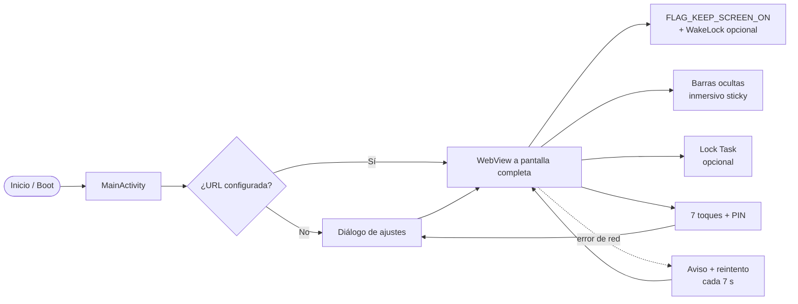

<div align="center">

# 🖥️ Kiosco Web

**Convertí cualquier tablet Android en un panel web a pantalla completa.**
Una URL. Sin barras del sistema. Sin que se apague la pantalla. Sin distracciones.

[](https://developer.android.com)
[](https://kotlinlang.org)
[](https://developer.android.com)
[](https://github.com/pabloberthold/kiosko/tags)


[Qué hace](#-qué-hace) · [Instalación](#-instalación) · [Configuración](#-configuración) · [Modo kiosco](#-modo-kiosco) · [Preguntas frecuentes](#-preguntas-frecuentes) · [Análisis de Fully](docs/analisis-fully.md)

</div>

---

## ✨ Qué hace

Kiosco Web es una app Android minimalista pensada para dejar una tablet mostrando **un único
sitio web**, como un dashboard, un panel de turnos o un cartel digital.

| | |
|---|---|
| 🖥️ **Pantalla completa real** | Oculta barras de estado y navegación, dibuja sobre el notch y las vuelve a ocultar cada vez que Android intenta mostrarlas. |
| 💡 **Nunca se apaga** | `FLAG_KEEP_SCREEN_ON` siempre activo, con opción de WakeLock forzado para casos difíciles. |
| 🔗 **Una sola URL** | WebView con JavaScript, cookies, almacenamiento local, descargas, subida de archivos y video en pantalla completa. |
| 🔐 **Salida con PIN** | 7 toques rápidos en la esquina superior izquierda y PIN (por defecto `1234`). El botón *atrás* no cierra la app. |
| 📶 **Resistente a cortes** | Si se cae la conexión muestra un aviso y reintenta solo cada 7 segundos. |
| 🔄 **Arranque automático** | Reabre el panel al encender el equipo (según las restricciones de Android 10+). |
| 🧭 **Orientación fija** | Sensor, vertical u horizontal, configurable. |
| 🧱 **Kiosco opcional** | *Lock Task* con screen pinning o device owner para que nadie salga de la app. |
| 🪶 **Sin vueltas** | Sin telemetría, sin cuentas, sin servicios en la nube. ~3 MB de APK. |

> Basada en el análisis estático del APK de **Fully Single App Kiosk** hecho con REA.
> El mapa completo de funciones está en [`docs/analisis-fully.md`](docs/analisis-fully.md).

---

## 🚀 Instalación

### Requisitos

- Tablet con **Android 7.0 (API 24)** o superior.
- WebView del sistema actualizado.
- Para compilar: **JDK 17**, **Android SDK 34** y Gradle 8.10 (incluido vía wrapper).

### Compilar e instalar

```bash
git clone https://github.com/pabloberthold/kiosko.git
cd kiosko

# Apuntá al SDK de Android (este archivo no se versiona)
echo "sdk.dir=$HOME/Android/Sdk" > local.properties

JAVA_HOME=/usr/lib/jvm/java-17-openjdk-amd64 ./gradlew assembleDebug
adb install -r app/build/outputs/apk/debug/app-debug.apk
```

### Primer arranque

1. Abrí **Kiosco Web** en la tablet.
2. Pegá la URL del panel y tocá **Guardar**.
3. La app queda a pantalla completa con la pantalla encendida.

También podés lanzarla ya configurada desde `adb`:

```bash
adb shell am start -n com.kiosko.web/.MainActivity --es url "https://mi-panel.local"
```

---

## ⚙️ Configuración

Tocá **7 veces rápido** la esquina superior izquierda y entrá con el PIN (`1234`).

| Opción | Default | Para qué sirve |
|---|---|---|
| **URL de inicio** | — | Sitio que se muestra. Acepta `http`, `https`, `file` y `content`. |
| **PIN de administración** | `1234` | Protege los ajustes y la salida. Vacío = sin PIN. |
| **Mantener pantalla encendida** | Activado | Evita el apagado mientras la app está visible. |
| **WakeLock (avanzado)** | Desactivado | Fuerza la pantalla encendida incluso con otras apps encima o protectores de pantalla. |
| **Arranque automático** | Desactivado | Reabre el kiosco al reiniciar el equipo. |
| **Modo kiosco estricto** | Desactivado | Activa *Lock Task* para bloquear el sistema. |
| **Orientación** | Sensor | Sensor, vertical u horizontal. |

### Atajos por ADB

```bash
# Cambiar la URL sin abrir los ajustes
adb shell am start -n com.kiosko.web/.MainActivity --es url "https://otra-url"

# Ver logs de la app
adb logcat -s KioscoWeb

# Evitar el apagado de pantalla a nivel sistema (opcional)
adb shell settings put system screen_off_timeout 2147483647
```

---

## 🔒 Modo kiosco

Hay tres niveles, de menor a mayor bloqueo. Podés quedarte en el primero para la mayoría de
los paneles.

| Nivel | Cómo | Qué bloquea | Cómo se sale |
|---|---|---|---|
| **1. Inmersivo** | Ya activo por defecto | Barras del sistema y botón atrás | 7 toques + PIN |
| **2. Screen pinning** | Ajustes → *Modo kiosco estricto* | Pantalla fijada por Android | Gesto de pinning + PIN |
| **3. Device owner** | `dpm set-device-owner` + modo estricto | Todo: home, recientes, ajustes, teclas | Solo con PIN o ADB |

### Device owner

Requiere un equipo sin cuentas configuradas (o recién restablecido de fábrica):

```bash
adb shell dpm set-device-owner com.kiosko.web/.KioskDeviceAdminReceiver
```

Opcional: dejar la app como launcher principal.

```bash
adb shell cmd package set-home-activity com.kiosko.web/.MainActivity
```

Para revertirlo:

```bash
adb shell dpm remove-active-admin com.kiosko.web/.KioskDeviceAdminReceiver
```

> El modo device owner es opcional. Sin él, la app funciona igual y el nivel 2 usa el
> mecanismo estándar de Android.

---

## 🧠 Cómo funciona



- **Pantalla encendida**: flag de ventana `FLAG_KEEP_SCREEN_ON`; el WakeLock queda como
  refuerzo para equipos que igualmente duermen la pantalla.
- **Pantalla completa**: `WindowInsetsController` (Android 11+) con fallback a
  `systemUiVisibility` para versiones viejas, más `layoutInDisplayCutoutMode` para el notch.
- **Persistencia**: `SharedPreferences`, sin base de datos ni nube.

### Estructura

```text
app/src/main/java/com/kiosko/web/
├── MainActivity.kt        # WebView, fullscreen, energía, ajustes y PIN
└── BootReceiver.kt        # arranque automático

app/src/main/res/
├── layout/activity_main.xml
├── layout/dialog_settings.xml
├── values/{strings,arrays,themes,colors}.xml
├── xml/device_admin.xml
└── drawable/ic_launcher.xml

docs/analisis-fully.md     # análisis del APK de Fully con REA
```

---

## ❓ Preguntas frecuentes

<details>
<summary><b>¿Se puede salir de la app?</b></summary>

Sí: 7 toques en la esquina superior izquierda, PIN y el botón **Salir de la app** de los
ajustes. Si nadie conoce el PIN, no hay salida desde la interfaz.
</details>

<details>
<summary><b>¿Necesita root?</b></summary>

No. Todo funciona sin root. El bloqueo total usa *device owner*, que se configura por ADB
una sola vez.
</details>

<details>
<summary><b>La pantalla se sigue apagando, ¿qué hago?</b></summary>

Activá **WakeLock (avanzado)** y desactivá la optimización de batería para la app en los
ajustes del fabricante. Como último recurso, fijá `screen_off_timeout` por ADB.
</details>

<details>
<summary><b>Aun así aparecen las barras al deslizar desde el borde.</b></summary>

Es el comportamiento *sticky* de Android: una barra temporal aparece al deslizar y se va
sola. Con **device owner** + modo kiosco estricto desaparecen del todo.
</details>

<details>
<summary><b>¿Arranca sola después de un reinicio?</b></summary>

Sí, si activás **Arranque automático**. En Android 10+ algunos fabricantes bloquean el
inicio en segundo plano; en ese caso dejá la app como *Home* o usá device owner.
</details>

<details>
<summary><b>¿Funciona con HTTP sin certificado?</b></summary>

Sí, el tráfico cleartext está habilitado para redes internas. Si tu panel usa HTTPS con
certificado inválido, la app lo rechaza a propósito.
</details>

<details>
<summary><b>¿Puedo mostrar otra app en vez de una web?</b></summary>

No: este proyecto es un kiosco **web**. Para encerrar apps nativas hace falta otro enfoque
(como el de Fully Single App Kiosk).
</details>

---

## 🗺️ Hoja de ruta

- [x] URL única, fullscreen y pantalla encendida
- [x] PIN, orientación y arranque automático
- [x] Reintento offline y manejo de descargas
- [x] Lock Task / device owner
- [ ] Protector de pantalla con reloj
- [ ] API JavaScript para controlar la app desde el sitio
- [ ] Lista blanca / negra de URLs
- [ ] Configuración remota (HTTP o MQTT)

## 🤝 Contribuir

Los issues y PRs son bienvenidos. Si encontrás un equipo donde la pantalla se apaga o las
barras no se ocultan, abrí un issue con marca, modelo y versión de Android.

## 📄 Licencia

Sin licencia definida por ahora. Si querés reutilizar el código, abrí un issue y lo vemos.
